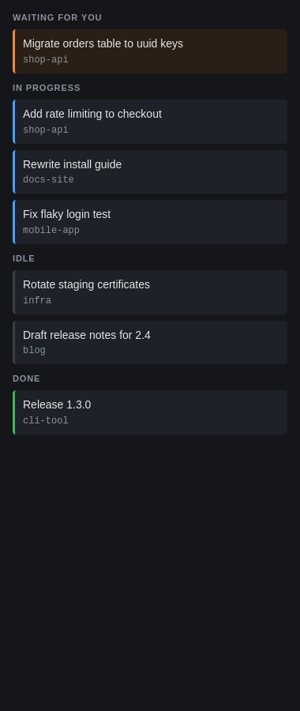
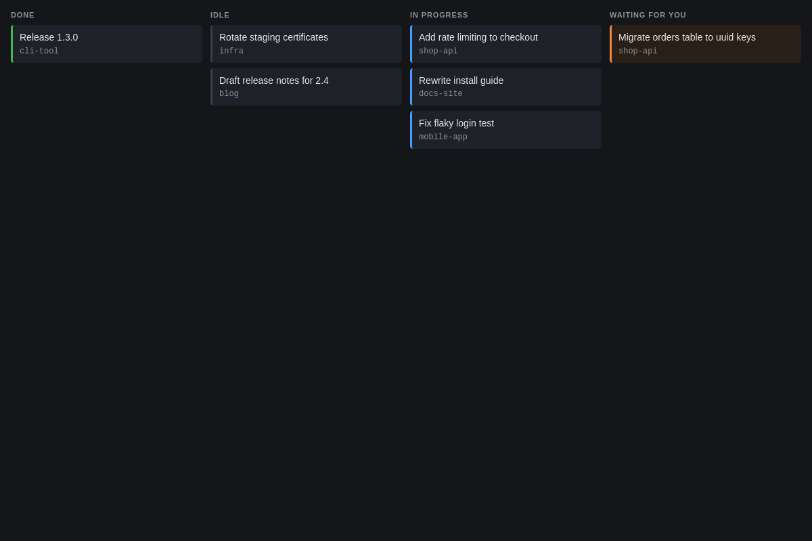

# herdr-dash

A kanban board for your [herdr](https://github.com/herdrdev/herdr) agents.
Every agent pane becomes a card in one of four columns: waiting for you,
in progress, idle, done. Click a card to focus that pane in herdr.

One Python file, standard library only. No install step.



In a wider window the sections become columns:



## Run

```sh
./herdr-dash.py
```

Open http://127.0.0.1:7655. The board connects to herdr's socket at
`~/.config/herdr/herdr.sock`; set `HERDR_SOCKET_PATH` to use another one.
herdr doesn't need to be running first. The board retries until it is.

## Open the board from your phone

To reach the board over a private network such as NetBird or Tailscale, set
`HERDR_DASH_BIND` to this computer's address on that network:

```sh
HERDR_DASH_BIND=100.64.0.7 ./herdr-dash.py
```

Then open `http://100.64.0.7:7655` on the phone. The board has no login, so
anyone on that network can see your sessions, read their recent output, focus
panes and send them prompts and key presses. Start the board after the network
is up; it skips an address that isn't there yet.

The board answers only at `127.0.0.1`, `localhost` or an address in
`HERDR_DASH_BIND`. To use a hostname, add it to `HERDR_DASH_BIND`. A request
for any other name gets a 403, and the board accepts actions only from its own
page.

The `Origin` check stops other websites, not other programs: anything that
can reach the port can send the header.

## How it works

herdr already classifies each pane as idle, working, blocked or done. The
board subscribes to herdr's pane events.

Each card has an animal icon on a coloured background. Hover over it for its
name, such as "blue fox". Cards on the board get different icons, and a card
keeps its icon until it disappears. The icons reset when you restart the
board.

A card that changed while you weren't looking at its pane gets a purple
outline until you focus it. A card whose session has exited dims for half a
minute, then disappears.

## Steer a session

Click a card to open it full screen. The view shows the session's icon, name
and title, and a recap of its recent output as plain text, refreshed every
five seconds. For Claude sessions, the recap leaves out the input box and
status line at the bottom of the terminal. It shows your last prompt as "You
asked" and Claude's answer as "Latest reply", without tool calls, their
results and status lines. Older output is under "Earlier output", which you
expand with a click. Tables keep their columns and scroll sideways. With a mouse, the cursor is
already in the prompt box; on a touch screen, tap it. Type a prompt and press
Enter to send it to that agent. When the agent shows a menu, the view has a
button for each option number, and you can also tap an option's line to choose
it. The `esc` and `enter` buttons send those keys to the agent. A control you
used turns green for a moment when the agent received it.

To return to the board, press the Esc key on your keyboard, click the back
arrow, or use the browser's back button or gesture. If you reopen the same
card, the text you typed is still there.

The recap shows whatever the terminal printed, including secrets.

## Hide a session

To keep a session off the board, start its name with a dot, for example
`/rename .diff` in Claude. The card appears only while that session waits for
you.

## Remote herdr servers

If you run herdr on other machines too, register each one as an ssh target:

```sh
./herdr-board register my-new-machine        # host from ~/.ssh/config
./herdr-board unregister my-new-machine
./herdr-board list
```

Each host gets its own tab.

The registry is a plain text file at `~/.config/herdr-dash/remotes`, one
target per line, read on every tick. Editing it by hand works too.

## Desktop launcher

`herdr-board` with no arguments starts the board if needed and opens it in
its own window. It expects [hello-browser](https://github.com/svandragt/hello-browser),
a small single-site browser for Linux. Without it, run `herdr-dash.py` and
open the URL in any browser.

## Licence

MIT. See `LICENSE`.
